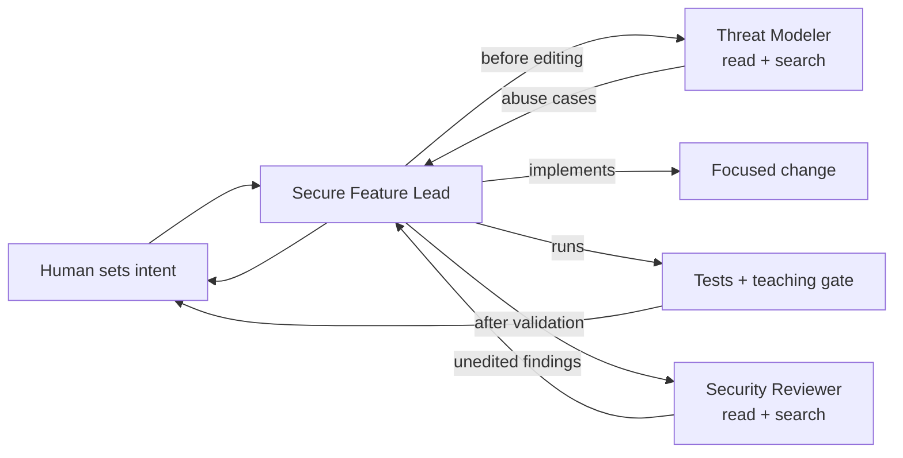

# Secure-by-Default Coding with GitHub Copilot

This small TypeScript API demonstrates how a team can give GitHub Copilot a security-aware operating context from the first prompt. It goes beyond basic code completion by composing repository instructions, path-specific rules, a reusable prompt, an agent skill, and specialist subagents into one reviewable workflow.

> **Training repository:** The starting code intentionally contains security weaknesses. Do not deploy it or reuse it as an application template.

## What This Demonstrates

| Customization | Role in the workflow |
| --- | --- |
| [Repository instructions](.github/copilot-instructions.md) | Security defaults that apply throughout the project |
| [API instructions](.github/instructions/api-security.instructions.md) | Controls automatically attached to production TypeScript work |
| [Test instructions](.github/instructions/security-tests.instructions.md) | Negative-test expectations for the test suite |
| [Secure Endpoint prompt](.github/prompts/secure-endpoint.prompt.md) | A repeatable, focused implementation task |
| [Security Review skill](.github/skills/security-review/SKILL.md) | A discoverable multi-step review workflow with a checklist resource |
| [Security Reviewer agent](.github/agents/security-reviewer.agent.md) | An isolated, read-only reviewer with a strict output contract |
| [Threat Modeler agent](.github/agents/threat-modeler.agent.md) | A hidden, read-only specialist invoked before implementation |
| [Secure Feature Lead agent](.github/agents/secure-feature-lead.agent.md) | An orchestrator that delegates, implements, validates, and reports provenance |

The customizations guide Copilot; they are not deterministic policy controls. Keep type checking, linting, tests, code review, and your existing scanning and runtime protections in the engineering system around the model.

## Prerequisites

- Node.js 20 or newer
- VS Code with GitHub Copilot and GitHub Copilot Chat
- Access to agent mode and repository customizations in your Copilot plan

## Start Here

```bash
npm install
npm test
npm run security:check
```

The contrast is intentional:

- `npm test` passes because the API meets its basic functional expectations.
- `npm run security:check` fails with five teaching findings because functional correctness is not a security review.

The security check is a deterministic prop for this workshop, not a general-purpose scanner.

## A Different Copilot Mental Model

Do not make one chat carry every role and every piece of context. Treat Copilot customizations as a small engineering system:



- **Instructions supply defaults.** They reduce repeated prompting.
- **Skills supply methods.** They load specialized procedures only when relevant.
- **Prompts package an entry point.** They route a focused task into the right workflow.
- **Subagents isolate roles and context.** A specialist returns a bounded result instead of filling the main chat with every intermediate detail.
- **Tools define capabilities.** The reviewer cannot edit or execute commands; the lead can.
- **Humans and repository controls decide.** Delegated review is useful evidence, not independent approval.

## One File, Every Way You Prompt

The agent team is the most visible part of this repository, but it is not the part most teams should adopt first. The instructions files do the majority of the work, and they apply to every way you ask Copilot for code in the editor.

| How you ask Copilot in the IDE | Applies your instructions? |
| --- | --- |
| Ask mode | Yes |
| Edit mode | Yes |
| Agent mode | Yes |
| Inline chat in the editor | Yes |
| `/review` on a selection or file | Yes |
| Inline completions and next edit suggestions | No |

Three consequences are worth stating plainly:

- You can get most of the value here by writing one instructions file with the right `applyTo` pattern. No custom agent, skill, or orchestration is required.
- These are plain text files in the working tree. `.github/` is a folder name VS Code looks for, not a hosting requirement, so they work with any version control system. Teammates get them by syncing the repository, and a rule change is a reviewable diff with an author and an approver.
- Inline completions do not consume instructions. That is exactly why type checking, tests, linting, and human review stay in the loop regardless of how good the instructions become.

If your organization also enables Copilot code review on pull requests, the coding agent, or the CLI, those surfaces read the same files. Nothing written here has to be redone.

## Try the Customizations

Open the repository folder in VS Code, reload the window so customizations are discovered, and open Copilot Chat in agent mode.

1. Ask for a new database helper and Express handler in a file under `src/`, then ask for the same thing in a file outside `src/`. Compare the generated SQL, input validation, and error handling. This is secure-by-default behavior with no review step involved.
2. Ask `What are the trust boundaries and exploitable security issues in #src/database.ts? Do not edit yet.`
3. Select the login handler in `src/app.ts` and run `/review`. Then make a small change through inline chat. Note that both reflect repository standards without any custom agent.
4. Select the **Security Reviewer** custom agent and ask it to review `src/`. Notice that it can inspect but cannot edit or run commands.
5. In a new agent chat, run `/security-review src/` to load the reusable review method directly.
6. Run `/secure-endpoint Add POST /password-reset/request without revealing whether an account exists`.
7. Watch **Secure Feature Lead** delegate pre-edit analysis to **Threat Modeler**, implement and validate, then delegate post-change review to **Security Reviewer**.
8. Review the raw subagent findings and command outcomes before accepting the result.

Copilot responses vary by model and context. Evaluate whether each answer cites real code paths, proposes a negative regression test, and states residual risk.

## Intentional Findings

The baseline contains five compact examples:

- SQL injection through string interpolation
- A fast digest used for password storage
- A fallback JWT signing secret
- Internal error details returned to clients
- No throttling on the login route

They are kept small so the conversation can focus on trust boundaries, evidence, and verification rather than framework setup.

## Commands

| Command | Purpose |
| --- | --- |
| `npm run dev` | Run the API with file watching |
| `npm test` | Run functional tests |
| `npm run typecheck` | Check strict TypeScript types |
| `npm run security:check` | Run the five workshop teaching checks |
| `npm run check` | Type-check and run functional tests |

## Discussion Prompts

- Which requirements belong in always-on instructions, and which belong in an on-demand skill?
- Which work needs a fresh context or a different tool boundary rather than another paragraph in the prompt?
- Which ways of prompting will a given standard actually reach?
- Who approves a rule change, and where does that change show up?
- Why are the Threat Modeler and Security Reviewer read-only, and why is that scoping rather than access control?
- Why is a reviewer delegated by the implementing agent advisory rather than independent approval?
- What can a deterministic tool prove that an instruction cannot?
- Which section of your existing secure coding standard would benefit most from being a scoped instructions file?
- How should a team measure whether these customizations reduce escaped security defects?

## Responsible Use

Review and test model-generated changes. Avoid putting real secrets, regulated data, or sensitive production information into prompts. These customizations make a standard versioned and reviewable; they are not a control and they do not produce compliance evidence. Report genuine vulnerabilities through the affected project's security process rather than a public issue.
